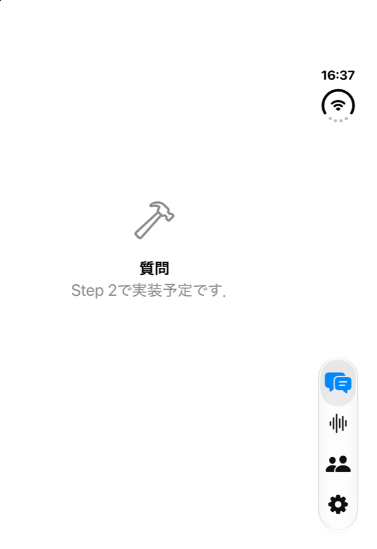

# EchoMindClient Step 0: プロジェクトの土台

## 1. 概要

EchoMindのiPhoneアプリ(クライアント)の実装の第一段階として，Xcodeプロジェクトの設定，ソースコードのフォルダ構成，Info.plistの設定，サーバーURLの設定と疎通確認の画面を実装した．あわせて，order_001からorder_005でEchoMindServerのAPI(録音開始時刻の送信，AAC形式，重複防止，処理状況の取得)を確認し，クライアントが前提とする通信仕様を確定した．通信仕様は`document.md`の「サーバーとの通信仕様」に記載した．

## 2. 実装内容

### 2.1 プロジェクト設定

テンプレートのプロジェクトはmacOS・visionOSを含むマルチプラットフォームの設定であった．Step 4以降で使用する`AVAudioSession`等はiOS専用のAPIであるため，対象をiPhoneに限定した(`SUPPORTED_PLATFORMS = iphoneos iphonesimulator`，`TARGETED_DEVICE_FAMILY = 1`)．マイク使用許可の説明文はビルド設定`INFOPLIST_KEY_NSMicrophoneUsageDescription`で指定した．ビルド設定のキーで表現できない項目は`EchoMindClient-Info.plist`に記述し，`INFOPLIST_FILE`で自動生成のInfo.plistに統合した．追加した項目は，バックグラウンドモード(`audio`はStep 4の常時録音，`processing`はStep 5のバックグラウンド送信のため)，BGTaskの識別子(`$(PRODUCT_BUNDLE_IDENTIFIER).upload`)，App Transport Security(ATS)の例外`NSAllowsLocalNetworking`である．この例外は，LAN内のサーバーへHTTPで接続して開発するために設けた．`EchoMindClient-Info.plist`はフォルダ同期の対象である`EchoMindClient/`の外に置き，リソースとして重複してコピーされることを防いでいる．

### 2.2 ソースコード

| ファイル | 役割 |
| :--- | :--- |
| `App/MyApp.swift` | アプリのエントリポイント．`ContentView`の代わりに`RootView`を表示する |
| `App/RootView.swift` | 質問・会話・人物・設定の4つのタブ．設定以外は未実装の案内を表示する |
| `Config/AppConfig.swift` | サーバーURLをUserDefaultsに保存し，http/httpsのスキームとホストの有無を検証して末尾のスラッシュを除く |
| `Services/ServerHealth.swift` | `GET /health`を呼び出し，`{"status": "ok"}`が返ることを確認する |
| `Features/Settings/SettingsView.swift` | サーバーURLの入力欄，形式エラーの表示，疎通確認のボタンと結果 |

テンプレートの`ContentView.swift`(`Playgrounds`のサンプルを含む)は削除した．

## 3. 動作確認

### 3.1 ビルド

Xcode 27.2の`xcodebuild`でiOSシミュレーター向けにビルドし，エラーと警告がないことを確認した．生成されたInfo.plistに`NSMicrophoneUsageDescription`，`UIBackgroundModes`(`audio`，`processing`)，`BGTaskSchedulerPermittedIdentifiers`(`devplaceholder.S3YGLIV5.EchoMindClient.upload`)，`NSAllowsLocalNetworking`が含まれることを確認した．

### 3.2 疎通確認のロジック

`AppConfig.swift`と`ServerHealth.swift`を確認用のプログラムと合わせてmacOS向けにコンパイルし，`/health`を模擬するローカルのHTTPサーバーに対して実行した．結果を以下に示す．

| 入力したURL | 結果 |
| :--- | :--- |
| `http://127.0.0.1:8765/` | 末尾のスラッシュを除いて接続し，成功 |
| `http://127.0.0.1:8765/wrong` | 「サーバーがHTTP 404を返しました．」 |
| `http://127.0.0.1:8765/other` | 「EchoMindサーバーの応答ではありません．」 |
| `ftp://x` | URLの形式が不正と判定 |
| `echomind.example.com` | URLの形式が不正と判定(スキームがない) |
| `http://127.0.0.1:1` | 接続エラー(Could not connect to the server.) |

### 3.3 シミュレーターでの起動

iOS 27.2のシミュレーターにインストールして起動し，4つのタブが表示されることを確認した．起動直後の画面を以下に示す．

その後，iPhone 17のシミュレーター(iOS 27.2)で，設定画面にCloudflare Tunnel経由のEchoMindServerのURLを入力して疎通確認を行い，「接続できました」と表示されることを確認した．シミュレーターは機種ごとに独立した端末として扱われるため，アプリは実行先として選択した機種にのみインストールされる．実機での実行は行っていない．

## 4. 未解決の論点・次に検討すべき事項

- Bundle Identifierは初期値の`devplaceholder.S3YGLIV5.EchoMindClient`のままである．実機で実行する前に正式な値へ変更する必要がある．BGTaskの識別子はBundle Identifierから自動で導出されるため，変更に追従する．
- `EchoMindClient.xcodeproj/xcuserdata/`は`.gitignore`に追加したが，初回コミットで既に追跡されているため，追跡を外すかどうかを決める必要がある．
- 次の作業はStep 1(APIクライアントと認証)である．APIクライアントの共通処理(Bearerトークンの付与，401時のログイン画面への遷移，エラーメッセージの`detail`の表示)と，Keychainへのトークンの保存を実装する．`ServerHealth`はAPIクライアントに統合することを検討する．
- サーバー側の残課題として，処理中の音声に対する停滞判定の閾値(30分)が実際の処理時間に適しているかを確認する必要がある．クライアントはStep 5で1ファイルずつ送信し，処理の完了を待ってから次を送ることで，この閾値を超えにくくする．
