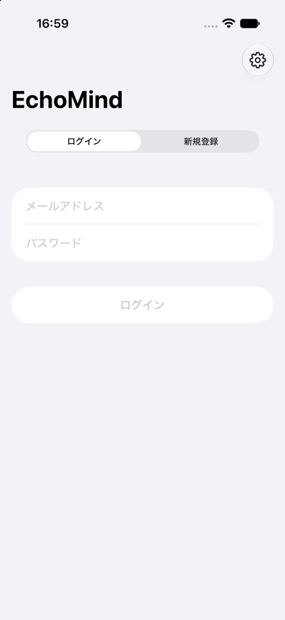

# EchoMindClient Step 1: APIクライアントと認証

## 1. 概要

EchoMindServerのAPIを呼び出す共通のクライアントと，アカウント登録・ログイン・ログアウトの機能を実装した．アクセストークン(JSON Web Token，JWT)はKeychainに保存し，トークンが保存されていればサーバーに問い合わせずにログイン済みとして扱う．あわせて，Step 0の確認として，iPhone 17のシミュレーターから実際のEchoMindServerへの疎通確認が成功したことを`report_006.md`に追記した．

## 2. 実装内容

### 2.1 APIクライアント

`Services/APIClient.swift`の`APIClient`は，`AppConfig`のサーバーURLとKeychainのアクセストークンを用いてリクエストを組み立て，レスポンスをデコードする．JSONのキーはサーバー側のスネークケース(例: `access_token`)とSwift側のキャメルケース(例: `accessToken`)を自動で変換する．エラーは`APIError`に分類し，画面にはその`localizedDescription`を表示する．分類と表示内容を以下に示す．

| 状況 | `APIError` | 表示する内容 |
| :--- | :--- | :--- |
| サーバーURLが未設定 | `serverURLNotConfigured` | 設定画面でURLを入力するよう案内する |
| 認証が必要なAPIで401 | `unauthorized` | ログインの期限切れを案内し，自動的にログアウトする |
| それ以外の4xx・5xx | `server` | FastAPIの`detail`が文字列であればそのまま表示し，422の検証エラーのように配列であればステータスコードに応じた文言を表示する |
| 通信の失敗 | `transport` | 接続できなかったことと，その理由を表示する |
| 応答の形式が不正 | `invalidResponse`，`decoding` | 応答を解釈できなかったことを表示する |

ログインAPIのような認証が不要なAPIで返る401は「パスワードが正しくない」という意味であるため，期限切れとは区別し，自動ログアウトの対象としない．サーバーが返す日時は，Pythonの`isoformat()`由来の形式(マイクロ秒と`+00:00`を含む形式)と，`Z`表記の形式の両方を解釈する．タイムゾーンの表記がない場合は，サーバーの規約に従いUTCとみなす．

### 2.2 認証とログイン状態

`Services/AuthSession.swift`の`AuthSession`がログイン状態を管理する．起動時はKeychainにアクセストークンがあるかどうかだけでログイン状態を決め，サーバーへの問い合わせを待たない．これは，Step 4以降の録音機能をサーバーに接続できない状態でも使えるようにするためである．ユーザー情報(`GET /api/auth/me`)はログイン後の画面を表示した時点で取得し，通信に失敗してもログイン状態は変えない．トークンが無効な場合は，APIクライアントが401を受けた時点で自動的にログアウトする．

APIクライアントの401処理は，アプリで使用する共有インスタンス`AuthSession.shared`にのみ紐づけた．当初はインスタンスの生成時に紐づけていたが，2つ目のインスタンスを生成して破棄すると401処理が失われ，自動ログアウトが機能しないことを動作確認で検出したため，この設計に変更した．

アクセストークンは`Services/KeychainStore.swift`でKeychainに保存する．保存の設定は`kSecAttrAccessibleAfterFirstUnlockThisDeviceOnly`とした．この設定では，端末の再起動後に一度ロックを解除すれば，画面ロック中でもトークンを読み出せる．Step 5で画面ロック中にバックグラウンドで送信する際にトークンが必要になるため，この設定を選んだ．

### 2.3 画面

`Features/Auth/LoginView.swift`は，ログインと新規登録を切り替えられる画面である．新規登録ではパスワードを確認用と合わせて2回入力させ，サーバーと同じく8文字以上であることを送信前に検証する．サーバーURLが未設定の場合は設定画面を開くボタンを表示し，右上の歯車ボタンからも設定画面をシートとして開ける．`App/RootView.swift`は，未ログインの場合にログイン画面を，ログイン済みの場合に4つのタブを表示する．設定画面には，ログイン中の場合のみアカウントの欄(メールアドレスとログアウト)を追加した．ログアウトは確認ダイアログを経て実行する．

## 3. 動作確認

### 3.1 ビルド

Xcode 27.2の`xcodebuild`でiOSシミュレーター向けにビルドし，エラーと警告がないことを確認した．iPhone 17のシミュレーター(iOS 27.2)で起動し，ログイン画面が表示されることを確認した(2.3節の画像)．

### 3.2 認証の流れ

EchoMindServerの認証API(`/api/auth/register`，`/api/auth/login`，`/api/auth/me`)と同じ応答を返すダミーのHTTPサーバーを用意した．アプリと同じソースファイル(`AppConfig`，`APIClient`，`KeychainStore`，`AuthSession`，`AuthModels`)を確認用のプログラムと合わせてmacOS向けにコンパイルし，以下の17項目を確認した．コンパイルではアプリと同じく既定のアクター分離をMainActorとした．

| 確認項目 | 結果 |
| :--- | :---: |
| 初期状態は未ログインである | 合格 |
| サーバーURLが未設定の場合に案内を表示する | 合格 |
| 短いパスワードでの登録で，サーバーの`detail`を表示する | 合格 |
| メールアドレスの形式エラー(422)で，形式エラーの文言を表示する | 合格 |
| 登録に成功するとログイン状態になる | 合格 |
| アクセストークンがKeychainに保存される | 合格 |
| ユーザー情報を取得できる | 合格 |
| Keychainにトークンがあれば，新しいインスタンスがログイン済みで始まる(再起動に相当) | 合格 |
| 登録済みのメールアドレスでの登録で，409の`detail`を表示する | 合格 |
| ログアウトするとトークンが削除される | 合格 |
| パスワードの誤りで，401の`detail`を表示し，期限切れとして扱わない | 合格 |
| ログインに成功する | 合格 |
| 日時を解釈できる(小数6桁と`+00:00`の形式) | 合格 |
| 日時を解釈できる(`Z`，`+09:00`，タイムゾーンなしの形式) | 合格 |
| サーバー側でトークンが無効になると，401で自動的にログアウトする | 合格 |
| トークンがない状態で認証が必要なAPIを呼ぶと，期限切れとして扱う | 合格 |
| サーバーに接続できない場合に，接続できなかったことを表示する | 合格 |

初回の実行では「サーバー側でトークンが無効になると，401で自動的にログアウトする」が不合格となった．原因は2.2節で述べた401処理の紐づけ方であり，修正後に全項目が合格した．

実際のEchoMindServerに対する登録・ログインと，シミュレーターの画面操作による確認は行っていない．実際のサーバーに対して登録すると，そのサーバーにアカウントが作成されるためである．

### 3.3 シミュレーターでのKeychainのエラー

シミュレーターで新規登録を行ったところ，「Keychainへの保存に失敗しました(OSStatus: -34018)」と表示された．-34018は`errSecMissingEntitlement`である．原因は，3.1節の確認のために署名を無効(`CODE_SIGNING_ALLOWED=NO`)にしてビルドしたアプリをシミュレーターにインストールしていたことであった．署名を無効にしたビルドには`application-identifier`のエンタイトルメントが含まれないため，シミュレーターでもKeychainを使用できない．署名を有効にしてビルドしたアプリには`application-identifier`(`AAFFQF4475.devplaceholder.S3YGLIV5.EchoMindClient`)が含まれることを確認し，シミュレーターのアプリを入れ替えた．Xcodeから実行する場合は自動的に署名されるため，この問題は起きない．

### 3.4 実際のサーバーでの確認

署名を有効にしたアプリで，iPhone 17のシミュレーターから実際のEchoMindServerにログインできることを確認した．また，ログイン後にアプリを終了して再起動した際にログインが不要であること，設定画面の疎通確認が正常に動作することを確認した．

## 4. 未解決の論点・次に検討すべき事項

- JWTの有効期限は7日であり，期限が切れると再ログインが必要になる．Step 5のバックグラウンド送信中に期限が切れた場合は送信を止めて録音ファイルを保持し，再ログイン後に再開する必要がある．サーバー側にトークンの更新APIを設けるかどうかも検討の余地がある．
- ログアウトしても，Step 4以降で端末に保存する未送信の録音ファイルは削除しない方針とする．別のアカウントでログインした場合の扱いはStep 5で決める必要がある．
- `ServerHealth`は`APIClient`と別に実装している．設定画面では保存前のURLに対して疎通確認を行うため現状のままとしたが，統合するかどうかは検討の余地がある．
- Bundle Identifierは仮の値`devplaceholder.S3YGLIV5.EchoMindClient`のままである．
- 次の作業はStep 2(QAチャット画面)である．`POST /api/chat`の呼び出しと，チャット履歴の端末内への保存(SwiftData)を実装する．
