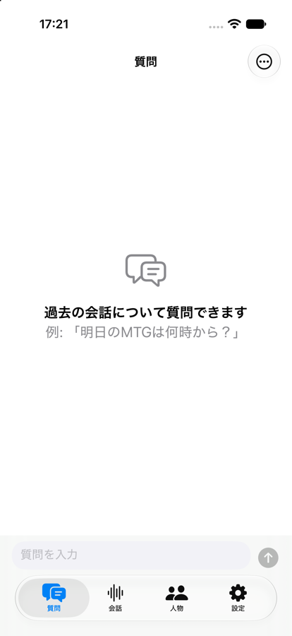

# EchoMindClient Step 2: QAチャット画面

## 1. 概要

過去の会話記録について質問し，EchoMindServerが生成した回答を表示する質問タブを実装した．サーバーは回答テキストと参照タイムスタンプのみを返し，チャット履歴を保存しないため，履歴は端末内にSwiftDataで保存する．あわせて，Step 1の確認として，実際のEchoMindServerへのログイン，再起動後のログイン状態の保持，疎通確認がシミュレーターで正常に動作したことを`report_007.md`に追記した．

## 2. 実装内容

### 2.1 質問の送信と履歴の保存

`Features/Chat/ChatController.swift`の`ChatController`は，質問を履歴に追加してから`POST /api/chat`を呼び出し，回答またはエラーを履歴に追加する．回答の生成では，サーバーがGemini APIのレート制限時に指数バックオフで再試行するため，応答に時間がかかる場合がある．そこで，このAPIの待ち時間は通常のAPI(30秒)より長い120秒とした．そのために，`APIClient`の`send`に待ち時間の引数を追加した．

送信に失敗した場合は，エラーメッセージと失敗した質問の本文を持つエラーのメッセージを履歴に保存する．画面では「再送」ボタンを表示し，再送するとエラーのメッセージを削除して同じ質問を送り直す．質問のメッセージは新たに追加しないため，履歴に同じ質問が重複しない．ログインの期限切れ(401)で失敗した場合も，自動的にログアウトした上で，同じ形式のエラーとして履歴に残す．再ログイン後に再送できる．

### 2.2 履歴のモデルとアカウントの区別

履歴の1件は`Models/ChatModels.swift`の`ChatMessage`(SwiftDataのモデル)で表す．各メッセージは，種類(質問，回答，エラー)，本文，参照日時，失敗した質問の本文，作成日時に加えて，送受信したアカウントのユーザーIDを持つ．画面ではログイン中のユーザーIDで履歴を絞り込むため，同じ端末で別のアカウントにログインしても履歴は混ざらない．ログアウトしても履歴は削除せず，同じアカウントで再びログインすると表示される．メニューの「履歴を削除」は，ログイン中のアカウントの履歴のみを削除する．

ユーザーIDを得るには`GET /api/auth/me`の応答が必要であるが，オフラインで起動した場合は取得できない．そこで，`AuthSession`がユーザー情報をUserDefaultsにも保存し，起動時に読み込むようにした．サーバーから取得できなかった場合は保存済みの値を保持し，ログアウト時に削除する．

### 2.3 画面

`Features/Chat/ChatView.swift`の質問タブでは，質問を右側に，回答を左側に吹き出しとして表示する．回答の下には，根拠となった発言の日時を「参照した会話」として表示する．日時はサーバーからUTCで受け取り，端末のタイムゾーン(日本時間)で「月/日 時:分」の形式に変換する．同じ分の日時は1つにまとめ，古い順に並べる．回答を待つ間は「回答を生成中…」を表示し，次の質問を送信できないようにする．履歴が空の場合は質問の例を表示する．新しいメッセージが追加されると，最新のメッセージまで自動的にスクロールする．参照日時から該当する会話へ移動する機能は，Step 3で会話の閲覧画面を実装した後に追加する．

## 3. 動作確認

### 3.1 ビルドと表示

Xcode 27.2の`xcodebuild`でiOSシミュレーター向けにビルドし，エラーと警告がないことを確認した．署名を有効にしてビルドしたアプリをiPhone 17のシミュレーター(iOS 27.2)にインストールし，ログイン済みの状態で質問タブが表示されることを確認した(2.3節の画像)．この表示は，実際のEchoMindServerからユーザー情報を取得できたことを示している．ユーザー情報を取得できていない場合は「アカウント情報を取得中…」が表示されるためである．

### 3.2 質問の送信と履歴

`POST /api/chat`と認証APIを模擬するダミーのHTTPサーバーを用意し，アプリと同じソースファイル(`ChatController`，`ChatModels`，`AuthSession`，`APIClient`等)を確認用のプログラムと合わせてmacOS向けにコンパイルした．SwiftDataはメモリ上の保存先を用い，以下の14項目を確認した．

| 確認項目 | 結果 |
| :--- | :---: |
| ユーザー情報を取得できる | 合格 |
| ユーザー情報が端末に保存され，新しいインスタンスで読み込める | 合格 |
| 質問と回答が順に保存される | 合格 |
| 回答本文が保存される | 合格 |
| 参照日時(小数6桁と`+00:00`の形式)を解釈して保存する | 合格 |
| 失敗時はサーバーの`detail`をエラーとして保存し，再送用の質問を持つ | 合格 |
| 再送するとエラーが消えて回答が追加され，質問は重複しない | 合格 |
| 回答を待つ間は回答待ちの状態になる | 合格 |
| 回答を受け取ると回答待ちの状態が解除される | 合格 |
| 別のアカウントの履歴は混ざらない | 合格 |
| 履歴の削除は対象のアカウントのみに適用される | 合格 |
| サーバーに接続できなくてもユーザー情報は保持される | 合格 |
| 401で自動的にログアウトし，保存したユーザー情報も削除される | 合格 |
| 期限切れで失敗した質問はエラーとして履歴に残り，再送できる | 合格 |

### 3.3 実際のサーバーでの確認

iPhone 17のシミュレーターから実際のEchoMindServerに質問を送信し，想定した質問に対して回答が得られることを確認した．

## 4. 未解決の論点・次に検討すべき事項

- 待ち時間の120秒は暫定値である．サーバー側のGemini APIの再試行が120秒を超える場合はタイムアウトとして表示されるため，実際の応答時間を見て調整する必要がある．
- 回答待ちの間に別のタブへ移動しても送信処理は続くが，アプリをバックグラウンドに移すと通信が中断される可能性がある．中断された場合はエラーとして履歴に残り，再送できる．
- 参照日時から該当する会話への移動は，Step 3(会話の閲覧)で実装する．サーバーは参照日時(発言の開始時刻)のみを返し，会話IDや発言IDを返さないため，クライアントでは日時から会話を探す必要がある．サーバーの`ChatResponse`に会話IDを含めることを提案する余地がある．
- 次の作業はStep 3(会話の閲覧，発言音声の再生，話者名の設定)である．
