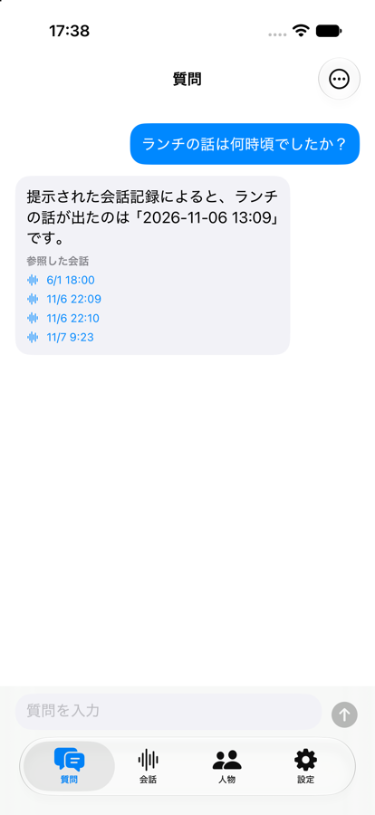

# EchoMindClient Step 3: 会話の閲覧，発言音声の再生，話者名の設定

## 1. 概要

サーバーに蓄積された会話を閲覧する会話タブと，話者(人物)の一覧と名前の設定を行う人物タブを実装した．会話の詳細では発言ごとに音声を再生できる．また，質問タブの回答に表示する参照日時をタップすると，その日時の発言を含む会話を開けるようにした．あわせて，Step 2の確認として，実際のEchoMindServerに質問を送信して想定した回答が得られたことを`report_009.md`に追記した．

## 2. 実装内容

### 2.1 閲覧APIと参照日時からの会話の探索

`Services/BrowseAPI.swift`に，会話一覧，会話詳細，人物一覧，名前の設定，発言音声の取得の各APIをまとめた．会話一覧は20件ずつ取得する．APIにクエリパラメータ(`limit`，`offset`，`person_id`)を渡せるよう，`APIClient`の`send`にクエリの引数を追加した．また，認証付きでファイルを取得する`data`を追加した．

質問の回答(`POST /api/chat`)は，根拠となった発言の開始時刻のみを返し，会話IDを返さない．そこで`BrowseAPI.conversation(containing:)`は，会話一覧を新しい順にたどり，開始から終了までの間に参照日時を含む会話を探す．会話一覧は開始時刻の新しい順に並ぶため，あるページの最後の会話が参照日時より前に始まっていれば，それ以降のページにも該当する会話はない．この場合は探索を打ち切る．サーバーの日時はマイクロ秒を含むため，開始と終了の比較では1秒の余裕を持たせた．

### 2.2 会話タブ

`Features/Conversations/ConversationListView.swift`は，会話の期間，参加者，発言数を一覧で表示する．末尾までスクロールすると続きを読み込み，引き下げると先頭から読み込み直す．この画面は，人物タブから人物ごとの会話一覧を表示する際にも，人物IDで絞り込んで用いる．`Features/Conversations/ConversationDetailView.swift`は，発言ごとに話者名，時刻，本文，再生ボタンを表示する．質問の参照日時から開いた場合は，開始時刻が参照日時から1秒以内の発言を強調表示し，その位置までスクロールする．`Features/Conversations/ConversationLookupView.swift`は，参照日時を含む会話を探す間は進行状況を表示し，見つかれば会話の詳細を，見つからなければその旨を表示する．

### 2.3 発言音声の再生

`GET /api/audio/{utterance_id}`は認証ヘッダが必要であるため，`AVPlayer`によるストリーミングは用いず，`Services/AudioClipPlayer.swift`で音声データ全体を取得してから`AVAudioPlayer`で再生する．発言の音声は数秒程度と短く，取得したデータは会話の詳細を開いている間メモリに保持して，同じ発言を再び再生する際に再利用する．再生中に別の発言を選ぶと前の再生を停止し，画面を閉じると再生を停止する．音声の再生に用いる`AVAudioSession`のカテゴリは，現時点では再生専用の`.playback`とした．Step 4で録音を実装する際に，録音と再生を両立できるカテゴリに統一する必要がある．

### 2.4 人物タブ

`Features/Persons/PersonsView.swift`は，人物を発言数の多い順に表示する．名前が未設定の人物は「名前未設定 (人物IDの先頭8文字)」と表示する．人物の行を左にスワイプするか長押しすると，名前を入力するダイアログを表示し，保存するとサーバーに反映して一覧を更新する．人物の行をタップすると，その人物が参加した会話の一覧を表示する．

### 2.5 日時の表示形式

実際のサーバーのデータで質問タブを表示したところ，ロケールに任せた書式では日本語環境で「11/07, 9:23」のように区切りの「,」とゼロ埋めが入ることがわかった．そこで，`Shared/DateLabels.swift`で書式を明示し，「11/7 9:23」，「11/7(土) 9:00〜9:30」の形式に統一した．質問タブの参照日時もこの書式を用いる．修正後の質問タブを以下に示す．

## 3. 動作確認

### 3.1 ビルドと表示

Xcode 27.2の`xcodebuild`でiOSシミュレーター向けにビルドし，エラーと警告がないことを確認した．初回のビルドでは，引数の既定値に用いた`BrowseAPI.pageSize`がMainActorに隔離されていることへの警告が出たため，`nonisolated`の定数に変更した．署名を有効にしてビルドしたアプリをiPhone 17のシミュレーターにインストールし，実際のサーバーに対する質問の履歴で，参照日時がリンクとして表示されることを確認した(2.5節の画像)．その後，ユーザーがiPhone 17のシミュレーターで会話タブ，人物タブ，会話の詳細，音声の再生，名前の設定，参照日時からの会話の表示を操作し，問題がないことを確認した．

### 3.2 閲覧APIと音声

閲覧APIを模擬するダミーのHTTPサーバーを用意した．このサーバーには，マイクロ秒を含む開始時刻を持つ45件の会話，名前が未設定の人物，`afconvert`で作成した1秒のAAC(.m4a)の音声を置いた．アプリと同じソースファイル(`BrowseAPI`，`BrowseModels`，`APIClient`，`DateLabels`等)を確認用のプログラムと合わせてmacOS向けにコンパイルし，以下の16項目を確認した．

| 確認項目 | 結果 |
| :--- | :---: |
| 1ページ目は20件で，新しい順に並ぶ | 合格 |
| 最終ページは残りの5件である | 合格 |
| `person_id`で会話を絞り込める | 合格 |
| 2ページ目にある会話を参照日時から見つける | 合格 |
| 会話を見つけた時点で探索を止める(2ページ) | 合格 |
| 開始時刻のマイクロ秒の差を許容して見つける | 合格 |
| 会話と会話の間の時刻では見つからない | 合格 |
| 参照日時より前に始まった会話に達したら探索を打ち切る(1ページ) | 合格 |
| 最も古い会話より前の時刻では見つからない | 合格 |
| 最終ページで探索を打ち切る(3ページ) | 合格 |
| 会話の詳細を解釈し，名前のない話者を人物IDで表示する | 合格 |
| 人物一覧を解釈する | 合格 |
| 名前を設定できる | 合格 |
| 空の名前ではサーバーの`detail`を表示する | 合格 |
| 音声データを変更なく取得する | 合格 |
| 取得したAAC(.m4a)を`AVAudioPlayer`で読み込める(長さ1.0秒) | 合格 |

日時の書式は，日本時間で日本語と英語のロケールについて出力を確認した．いずれも「11/7 9:23」，「11/7(土) 9:00〜9:30」の形式となり，日付をまたぐ会話は「11/11(水) 23:50〜11/12 0:10」となった．

### 3.3 回答と参照日時の9時間のずれ

2.5節の画像では，回答の本文が「2026-11-06 13:09」であるのに対し，参照日時は「11/6 22:09」と表示され，9時間ずれている．稼働中のEchoMindServerの`/openapi.json`を確認したところ，コミット07d9febで追加された`GET /api/upload/{upload_record_id}/status`が存在しなかった．このことから，稼働中のサーバーはタイムゾーンの修正(コミット82b1f0a)より前のコードで動作していると判断した．修正前のサーバーは，Gemini APIにUTCの時刻を日本時間と区別せずに渡し，参照日時をタイムゾーンの表記なしで返す．クライアントはタイムゾーンの表記がない日時をUTCとして解釈し，日本時間に変換して表示するため，回答の本文とは9時間ずれる．サーバーを最新のコードで再起動すれば，Gemini APIに日本時間が渡り，両者は一致すると考えられる．ただし，再起動後の確認は行っていない．

## 4. 未解決の論点・次に検討すべき事項

- 稼働中のEchoMindServerを最新のコードで再起動し，回答の本文と参照日時が一致することを確認する必要がある．Step 5で使用する`GET /api/upload/{upload_record_id}/status`も，再起動するまで利用できない．
- 参照日時からの会話の探索は，会話一覧を最大50ページ(1000件)までたどる．会話が多くなると探索に時間がかかるため，サーバーの`ChatResponse`に会話IDと発言IDを含めることを提案する余地がある．
- 名前を設定した後，会話タブの一覧は自動で更新されない．引き下げて再読み込みすると反映される．
- `AudioClipPlayer`は`AVAudioSession`のカテゴリを`.playback`に設定する．Step 4で録音中に再生した場合に録音が止まらないよう，カテゴリを統一する必要がある．
- 次の作業はStep 4(常時録音)である．実機での確認が必須となる．
